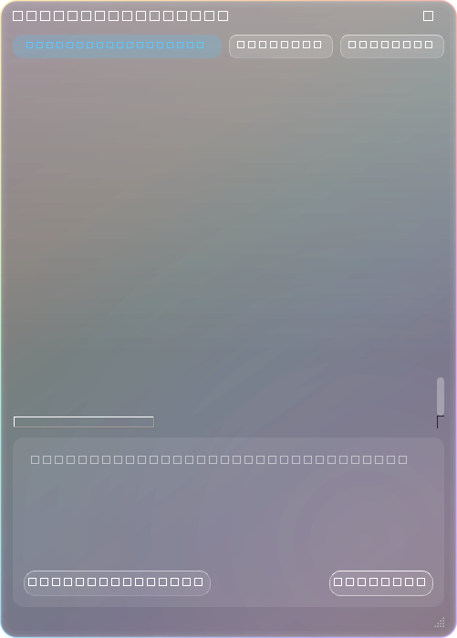
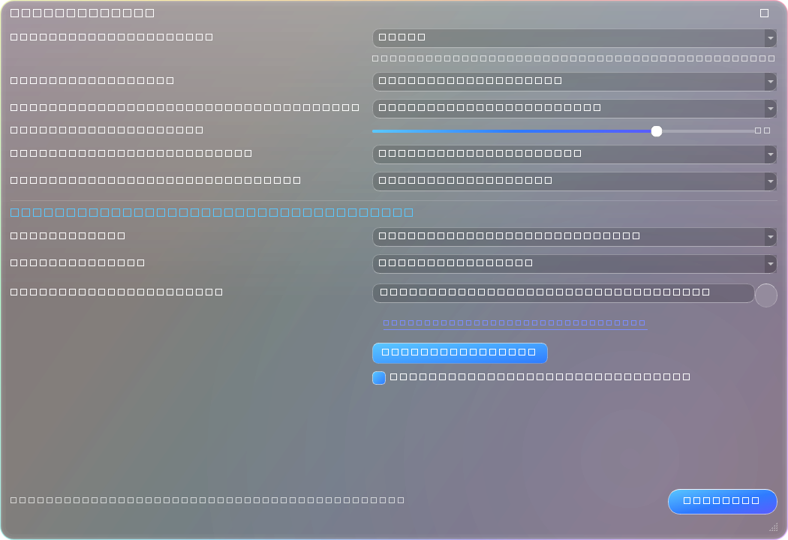
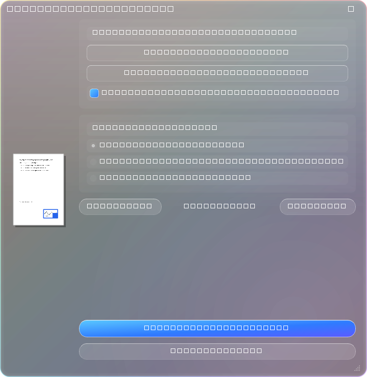
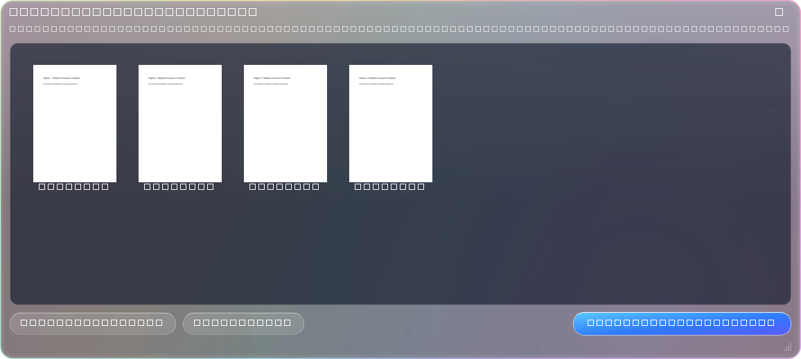

<div align="center">


# DocFAST PRO
### Sistema Radial Instantâneo de Conversão, Edição e Assistência por Inteligência Artificial
*Manipulação de documentos, planilhas, PDFs e imagens com interface Liquid-Glass de alta fidelidade para Windows, macOS e Linux.*

---

[](https://github.com/corefusiion/DocFAST/actions)
[](https://github.com/corefusiion/DocFAST/releases/latest)
[](https://python.org)
[](LICENSE)
[]()

<br>

[Visão Geral](#-visão-geral) • [Recursos Centrais](#-recursos-centrais) • [Galeria Visual](#-galeria-visual-da-interface) • [Matriz de Conversões](#-matriz-completa-de-conversões-e-ferramentas) • [Download](#-instalação-e-download) • [Desenvolvimento](#-execução-e-compilação) • [Créditos](#-créditos-e-desenvolvimento)

---

</div>

## ⬡ Visão Geral

O **DocFAST** redefine a velocidade de processamento de arquivos no ambiente corporativo e de trabalho diário. Em vez de depender de suítes de escritório pesadas ou serviços em nuvem inseguros com limites de upload e anúncios, o DocFAST opera **100% localmente com aceleração gráfica**.

Quando você começa a arrastar um arquivo ou pasta e pressiona uma tecla de atalho (`Shift`, `Ctrl` ou `Alt`), um **menu radial translúcido em estilo Liquid-Glass** é projetado diretamente sob o cursor do mouse. Ao soltar sobre a fatia correspondente, a conversão, assinatura, extração ou assistência por IA é executada instantaneamente em segundo plano.

```
Arrastar Arquivo ──▶ Pressionar [Shift] ──▶ Menu Radial Projetado ──▶ Soltar na Ação ──▶ Concluído em ms
```

---

## ✦ Recursos Centrais

### 1. Assistente Inteligente Windows: Ajuda AI & Ajuda AI Plus
* **Onipresença Operacional:** O assistente não fica preso ao navegador. Você pode selecionar qualquer texto ou dado em **células do Excel, documentos do Word, leitores de PDF, terminais, sistemas legados ou ERPs corporativos** e acionar o `Ajuda AI`.
* **Ajuda AI Plus com Visão Multimodal:** Captura a tela de forma imperceptível no instante do acionamento e anexa ao modelo de IA para analisar tabelas, gráficos, erros visuais na tela ou layouts de contratos.
* **Ecossistema Multimodelo (2025/2026):**
  * **Google Gemini:** `gemini-2.5-flash` *(Ultra rápido e recomendado)*, `gemini-2.5-pro`, `gemini-2.0-flash`.
  * **OpenAI (ChatGPT):** `gpt-4o-mini`, `gpt-4o`, `o3-mini`, `gpt-4.5-preview`.
  * **Anthropic Claude:** `claude-3-7-sonnet`, `claude-3-5-sonnet`, `claude-3-5-haiku`.
  * **Ambiente Local / OpenCode:** Suporte direto ao Ollama / OpenCode (`llama3.3`, `qwen2.5-coder`, `deepseek-r1`) com endpoint customizado para ambientes corporativos desconectados da internet.
* **Interface Docked com Fixação (📌):** A janela de chat fixa-se na lateral direita da sua área de trabalho enquanto você continua navegando ou alterando planilhas, mantendo o histórico de conversas gravado localmente.
* **Validação de API em Tempo Real:** Botão `⚡ Testar Conexão` integrado nas preferências para checar latência e credenciais antes de salvar.

---

### 2. Assinatura e Carimbo Digital de Alta Resolução em PDFs
* **Remoção Inteligente de Fundo:** Fotografe ou digitalize sua rubrica em folha de papel. O DocFAST analisa o limiar de luminância de cada pixel e elimina o fundo cinza/branco, preservando apenas o traço original com transparência perfeita.
* **Pad Vetorial de Desenho:** Assine na hora utilizando o mouse ou canetas stylus com suavização de curva vetorial e antialiasing contínuo.
* **Aplicação Flexível:** Posicione e redimensione com preview em tempo real. Escolha aplicar na página atual, na última página ou em todas as folhas do contrato de forma automática.
* **Opções de Exportação:** Salve ao lado do original como `(Assinado).pdf` ou utilize o explorador nativo para salvar em qualquer pasta de rede.

---

### 3. Reorganização Visual de Páginas (Thumbnail Grid)
* **Reordenação Drag & Drop:** Visualize todas as páginas do PDF em uma grade interativa e reordene páginas arrastando miniaturas.
* **Rotação e Exclusão Individual:** Corrija documentos escaneados de cabeça para baixo com rotação de 90°/180° e remova páginas em branco com um clique.

---

### 4. Engenharia de Planilhas Corporativas
* Suporte nativo para **Excel (.xlsx, .xls, .xlsm com macros, .xlsb)** e arquivos tabulares **CSV/TSV**.
* Conversão direta para **PDF formatado** (com cabeçalhos e larguras proporcionais calculadas), **JSON estruturado** e **tabelas HTML responsivas** sem depender do Microsoft Office instalado.

---

### 5. Conversão em Lote de Imagens
* **PDF Único (Consolidado):** Selecione dezenas de comprovantes, notas ou imagens e agrupe em um único PDF em ordem sequencial.
* **PDFs Separados:** Converte cada imagem de um diretório em seu respectivo arquivo PDF individual em lote.
* Suporte universal: **PNG, JPG, WEBP, AVIF, HEIC/HEIF (iOS), TIFF, BMP, ICO e GIF**.

---

### 6. Área de Transferência & Integração com Desktop
* **Salvamento Direto na Área de Trabalho:** Ao acionar o DocFAST pela área de transferência, seus arquivos são salvos diretamente no seu Desktop (`Área de Trabalho`), com suporte a ambientes sincronizados pelo OneDrive.
* **Menu de Ações Rápidas de Texto:** Ao copiar qualquer bloco de texto, o DocFAST oferece opções para salvar diretamente como **TXT**, documento **DOCX**, documento **PDF** ou iniciar o diálogo de **Ajuda AI**.

---

### 7. Compactação e Extração ZIP Nativa
* Para pastas inteiras, executáveis, arquivos desconhecidos ou planilhas com macros:
  * **Zip (Normal):** Compactação rápida multithread para compartilhamento ágil.
  * **Zip (Max):** Compressão máxima (nível 9) para redução extrema de tamanho.
  * **Extrair:** Descompactação instantânea de arquivos `.zip` em uma pasta limpa ao lado do arquivo.

---

### 8. Integração com o Menu do Botão Direito do Windows (Explorer)
* **Acesso Nativo com 1 Clique:** Sem precisar arrastar o arquivo, clique com o botão direito em qualquer documento, imagem, planilha ou pasta no Windows Explorer:
  * 🔘 **DocFAST — Menu Radial** *(projeta o menu na posição do cursor)*
  * ✨ **DocFAST — Ajuda AI** *(abre o chat de IA analisando o arquivo na hora)*
  * 🗜️ **DocFAST — Compactar (Zip)** *(comprime arquivos ou pastas instantaneamente)*
* **Ativação por Usuário:** Pode ser ativado ou desativado com uma caixa de seleção nas Configurações, sem exigir privilégios de administrador.

---

### 9. Diagnóstico de Serviço & Saúde do Disco (Health Card)
* **Monitoramento do Sistema em Tempo Real:** Cartão flutuante em Liquid-Glass com uma engrenagem rotativa suave que exibe:
  * 💾 **Espaço em Disco (C:)**: Barra visual com espaço livre e percentual utilizado.
  * 🗑️ **Lixeira do Windows**: Contagem de arquivos e tamanho ocupado, com botão de limpeza imediata.
  * 🧠 **Memória RAM**: Carga do sistema e memória disponível.
  * 💡 **Dicas Rotativas de Produtividade**: Truques e atalhos para acelerar seu fluxo de trabalho.
  * **Alertas Periódicos Opcionais:** Notificações programáveis a cada 30 min, 1h ou 2h configuráveis nas preferências.

---

### 10. Motor Visual Liquid-Glass com 5 Temas Suaves
* Efeito de vidro translúcido acrílico (Windows DWM API e shaders SDF).
* 5 Paletas de cores suaves para combinar com qualquer preferência:
  * **Aurora Violeta** *(Padrão contemporâneo)*
  * **Preto Transparente Glass** *(Dark minimalista de alto contraste)*
  * **Cinza Suave Translúcido** *(Slate corporativo neutro)*
  * **Azul Fraco Suave** *(Sky Blue descansado)*
  * **Verde Menta Suave** *(Mint Frost equilibrado)*

---

## 📸 Galeria Visual da Interface

<div align="center">

### Menu Radial Translúcido Liquid-Glass
*Projetado sob o cursor em milissegundos ao pressionar a tecla de gatilho durante o arrasto de arquivos.*


<br>

| 🤖 Ajuda AI Multimodal | ⚙️ Configurações & Provedores LLM |
| :---: | :---: |
|  |  |
| *Chat lateral flutuante com suporte a código e visão de tela* | *Seleção de temas visuais e validação de chaves de API* |

<br>

| ✍️ Assinatura & Carimbo em PDF | 📑 Organizador Visual de Páginas |
| :---: | :---: |
|  |  |
| *Remoção automática de fundo branco e posicionamento visual* | *Grade interativa com reordenação por arrasto e rotação* |

</div>

---

## 📊 Matriz Completa de Conversões e Ferramentas

| Categoria | Formatos de Origem | Formatos de Saída | Ferramentas Visuais Integradas |
| :--- | :--- | :--- | :--- |
| **Imagens** | JPG, PNG, WEBP, HEIC, AVIF, TIFF, BMP, ICO, GIF | PNG, JPG, WEBP, AVIF, TIFF, BMP, ICO, PDF | Compactar (tamanho alvo), Redimensionar, Recortar, Anotar, Tarjar (censura), Fundo gradiente, Filtros de cor, Limpeza de Metadados EXIF/GPS |
| **Documentos PDF** | PDF | JPG, PNG, DOCX (Word), TXT | ✍️ Assinar / Carimbar, 📑 Organizar Páginas, Juntar PDFs, Dividir PDF, Compactar, Proteger por Senha (AES-256), Extrair Imagens |
| **Planilhas** | XLSX, XLS, XLSM, XLSB, CSV, TSV | PDF formatado, XLSX, CSV, JSON, HTML | Visualização rápida de dados, exportação estruturada |
| **Documentos Word** | DOCX | PDF, TXT | Conversão veloz de contratos e relatórios |
| **Textos & Notas** | TXT, MD | PDF, DOCX | Renderização tipográfica limpa |
| **Área de Transferência** | Clipboard (PrintScreen ou Texto) | PNG, JPG, PDF, TXT, DOCX, Desktop | ✨ Ajuda AI, Anotações com setas, salvamento no Desktop |
| **Pastas & Arquivos Diversos** | Pastas, ZIP, Arquivos Genéricos | Zip (Normal), Zip (Max), Extrair | Compactação e extração de pastas sem programas pesados |

---

## 📥 Instalação e Download

Baixe as versões finais compiladas diretamente da página oficial de lançamentos:

👉 **[Download da Última Versão do DocFAST (GitHub Releases)](https://github.com/corefusiion/DocFAST/releases/latest)**

### Opções para Windows:
* **📦 DocFAST-Setup.exe (Recomendado):** Instalador para usuário (não exige privilégios de administrador). Cria atalhos no Menu Iniciar, inicialização opcional com o Windows e integração com o menu de contexto do botão direito do mouse (*"DocFAST…"* e *"Enviar para → DocFAST"*).
* **⚡ DocFAST.exe (Portátil / Standalone):** Executável único de clique duplo. Não requer instalação, funcionando perfeitamente em pendrives ou pastas compartilhadas de trabalho.

---

## 🛠️ Execução e Compilação

Para executar ou colaborar no desenvolvimento do código-fonte:

### Requisitos:
* Python 3.11 ou superior
* Sistema operacional: Windows 10/11, macOS 12+ ou Linux moderno

```bash
# 1. Clonar o repositório
git clone https://github.com/corefusiion/DocFAST.git
cd DocFAST

# 2. Criar e ativar o ambiente virtual
python -m venv .venv
.\.venv\Scripts\Activate.ps1    # No Windows PowerShell
# source .venv/bin/activate     # No Linux / macOS

# 3. Instalar dependências
pip install -r requirements.txt

# 4. Executar a aplicação
python run.py
```

### Validações e Testes:
```bash
# Executar a suíte de testes unitários (35 testes)
python -m pytest -v

# Executar o autoteste de integridade do executável
python run.py --selftest
```

### Compilação do Executável com PyInstaller:
```bash
# Compilar versão de pasta (base para o instalador)
pyinstaller DocFAST.spec --noconfirm

# Compilar versão portátil única (DocFAST.exe)
$env:ONEFILE="1"; pyinstaller DocFAST.spec --noconfirm
```

---

## 💖 Apoie o Projeto

<div align="center">

Se o **DocFAST** acelerou a sua produtividade diária, economizou tempo no tratamento de documentos ou ajudou na sua rotina de trabalho, considere apoiar o desenvolvimento de novas funcionalidades através dos nossos canais oficiais:

<br>

<p align="center">
  <a href="https://ko-fi.com/corefusion" target="_blank" rel="noopener noreferrer">
    
  </a>
  &nbsp;&nbsp;&nbsp;&nbsp;
  <a href="https://docfastbr.lovable.app/" target="_blank" rel="noopener noreferrer">
    
  </a>
</p>

</div>

---

## 👨‍💻 Créditos e Licença

* **Autor e Desenvolvedor:** **Gleisson Santos**  
* **Código-Fonte:** [Repositório Oficial no GitHub](https://github.com/corefusiion/DocFAST)  
* **Licença:** Código aberto sob a licença [MIT](LICENSE).
