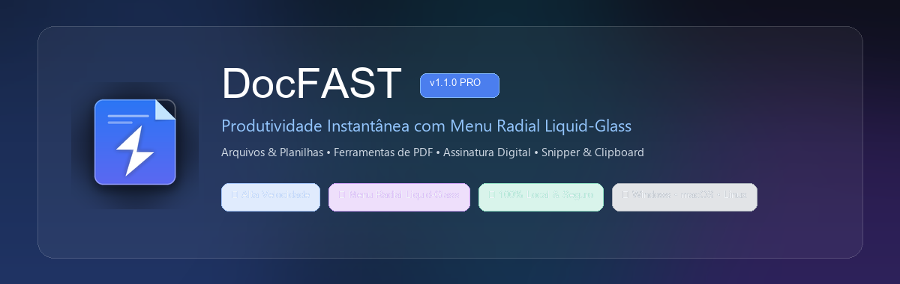

<div align="center">



# DocFAST

**Conversor & Editor Instantâneo com Menu Radial em Liquid-Glass**  
*Produtividade extrema na ponta do seu cursor para Windows, macOS e Linux.*

[](https://github.com/corefusiion/DocFAST/actions)
[](https://github.com/corefusiion/DocFAST/releases/latest)
[](LICENSE)
[](https://python.org)
[]()

<p align="center">
  <a href="#-o-que-é-o-docfast">Sobre</a> •
  <a href="#-principais-recursos">Recursos</a> •
  <a href="#-como-usar">Como Usar</a> •
  <a href="#-matriz-de-conversões-e-ferramentas">Conversões</a> •
  <a href="#-tecnologia-e-visual">Design</a> •
  <a href="#-instalação-e-download">Instalação</a> •
  <a href="#-créditos-e-desenvolvimento">Créditos</a> •
  <a href="#-apoie-o-projeto--doação">Doação</a>
</p>

---

</div>

## 🚀 O que é o DocFAST?

O **DocFAST** é uma ferramenta de produtividade projetada para transformar completamente como você trabalha com arquivos diários. 

Esqueça o processo lento de abrir programas pesados como Adobe Acrobat, Photoshop ou sites de terceiros cheios de anúncios só para converter uma planilha, assinar um contrato, juntar imagens em PDF ou recortar um documento:

> **Com o DocFAST, basta arrastar qualquer arquivo no seu computador, pressionar a tecla `Shift` e soltar na fatia desejada do menu radial translúcido.**

O arquivo convertido ou editado é salvo instantaneamente ao lado do original, sem alterar seu arquivo de origem!

---

## ✨ Principais Recursos

### 1. ✍️ Assinatura e Carimbo Visual em PDF
* **Pad de Assinatura Integrado**: Desenhe sua assinatura com mouse ou caneta stylus com suavização vetorial.
* **Carregamento de Imagem de Rubrica**: Importe uma foto da sua assinatura ou carimbo. O DocFAST **remove o fundo branco automaticamente**, gerando transparência perfeita.
* **Posicionamento Visual**: Arraste e redimensione a assinatura diretamente sobre a página do contrato.
* **Aplicação Flexível**: Aplique na página atual, apenas na última página ou em todas as folhas do documento com 1 clique.
* **Salvamento Inteligente**: Salve ao lado do original como `(Assinado).pdf` ou utilize `Salvar Como…` para escolher qualquer pasta.

### 2. 📊 Conversões Avançadas de Planilhas
* Suporte nativo para **Excel (.xlsx, .xls)** e **CSV (.csv)**.
* Converta planilhas diretamente para **PDF formatado**, **JSON estruturado**, **Tabela HTML** ou exporte para outros formatos sem precisar abrir o Office.

### 3. 🖼️ Conversão Inteligente de Múltiplas Imagens
* **PDF (1 doc)**: Selecione dezenas de imagens em uma pasta e junte todas em **um único PDF consolidado** na ordem correta.
* **PDF (sep)**: Converta todas as imagens em PDFs individuais com apenas um movimento.
* Conversões em lote entre formatos de imagem modernos: **PNG, JPG, WEBP, AVIF, HEIC, TIFF, BMP, ICO**.

### 4. 📑 Organizador Visual de Páginas de PDF (Thumbnail Grid)
* Visualize as miniaturas de todas as páginas do PDF em uma grade interativa.
* **Reorganização Drag & Drop**: Arraste para alterar a ordem das páginas livremente.
* **Rotação Individual**: Gire páginas digitalizadas de cabeça para baixo em 90°, 180° ou 270°.
* **Exclusão Rápida**: Remova páginas em branco ou desnecessárias com uma tecla.

### 5. 📋 Captura de Tela (PrintScreen Snipper) & Clipboard
* **Captura de Tela com Seleção**: Selecione qualquer região da tela pelo menu da bandeja e converta na hora para **PNG, JPG, PDF** ou abra no editor de **Anotações**.
* **Integração com a Área de Transferência**: Pressione `Ctrl + C` em qualquer imagem ou texto e acione o DocFAST para converter sem precisar abrir o Paint.

### 6. 🎨 Interface Liquid-Glass com Tecnologia Acrílica
* Renderização translúcida real que desfoca e refrata a área de trabalho em tempo real, com borda iridescente (arco-íris).
* Notificações flutuantes em formato de cartões de vidro com botões rápidos: **Abrir**, **Mostrar na Pasta** e **Desfazer** (envia o arquivo criado para a Lixeira).

### 7. 🇧🇷 Interface 100% em Português (com seletor PT-BR / EN)
* Menus, janelas e dicas totalmente localizados para Português do Brasil, com opção de alternar dinamicamente para Inglês nas Configurações.

---

## 🎮 Como Usar


1. **Selecione e Arraste**: Comece a arrastar um arquivo ou pasta no Windows Explorer, Finder ou desktop.
2. **Pressione a Tecla de Disparo**: Aperte a tecla **Shift** (configurável para Ctrl ou Alt). O menu radial em formato de vidro surgirá instantaneamente sob o cursor.
3. **Solte o Arquivo**: Solte o mouse sobre a fatia da conversão ou ferramenta desejada.
4. **Alterne entre Anéis**: Pressione **Shift** novamente enquanto o menu estiver aberto para alternar entre o anel de **Conversão** e o anel de **Ferramentas**.

> **Dica:** Você também pode clicar com o botão direito no arquivo e escolher **DocFAST…**, usar o menu **Enviar para → DocFAST** ou usar o ícone na bandeja do sistema.

---

## 📊 Matriz de Conversões e Ferramentas

| Tipo de Arquivo | Conversão Disponível | Ferramentas Visuais Integradas |
|---|---|---|
| **Imagens** <br>*(JPG, PNG, WEBP, HEIC, AVIF, TIFF, BMP, GIF, ICO)* | Qualquer formato de imagem ou **PDF** (juntar em 1 PDF ou PDFs separados) | **Compactar** (por qualidade ou tamanho alvo ex: "< 500 KB") • **Redimensionar** • **Recortar** • **Anotar** (setas, caixas, texto, marcador) • **Tarjar** (censura permanente) • **Adicionar Fundo** (gradiente) • **Editar** (cor, luz, contraste, P&B) • **Metadados** (limpeza de GPS e EXIF) |
| **Documentos PDF** | **JPG / PNG** (uma imagem por página), **DOCX** (Word editável), **TXT** | **✍️ Assinar / Carimbar** • **📑 Organizar Páginas** (reordenar, girar, excluir) • **Juntar PDFs** • **Dividir PDF** • **Compactar** • **Proteger com Senha (AES-256)** • **Extrair Imagens** |
| **Planilhas** <br>*(XLSX, XLS, CSV)* | **PDF**, **CSV**, **JSON**, **HTML**, **XLSX** | Visualização rápida de dados e conversão tabular em lote |
| **Documentos Word** <br>*(DOCX)* | **PDF** (renderização nativa de alta fidelidade), **TXT** | Conversão veloz de relatórios e contratos |
| **Textos & Markdown** <br>*(TXT, MD)* | **PDF**, **DOCX** | Formatação limpa para leitura e compartilhamento |
| **Captura / Clipboard** | **PNG**, **JPG**, **PDF**, **Anotação** | Captura de tela livre com atalhos na bandeja |

---

## 📥 Instalação e Download

Baixe os executáveis prontos para uso diretamente na página oficial de lançamentos:

👉 **[Download da Última Versão do DocFAST (GitHub Releases)](https://github.com/corefusiion/DocFAST/releases/latest)**

> **💡 Ideal para compartilhar com colegas de trabalho:**  
> O aplicativo é compilado automaticamente pelo **GitHub Actions** em executáveis 100% autossuficientes. Seus colegas **não precisam** instalar Python, Git ou bibliotecas na máquina deles! Basta baixar e usar:

* 📦 **DocFAST-Setup.exe** *(Recomendado para Windows)*: Instalador completo por usuário (não exige privilégios de administrador). Adiciona o DocFAST ao menu Iniciar, inicialização automática opcional e atalho no menu de contexto do botão direito do mouse (*"DocFAST…"* e *"Enviar para → DocFAST"*).
* ⚡ **DocFAST.exe** *(Portátil / Standalone)*: Executável único de clique duplo. Não instala nada no sistema operacional, perfeito para rodar direto de um pendrive ou pasta temporária.
* 🍏 **macOS**: Imagem `.dmg` nativa para processadores Apple Silicon (M1/M2/M3/M4) e Intel.
* 🐧 **Linux**: Pacote `.deb` compatível com Debian 12+, Ubuntu 23.04+, Linux Mint e derivados.

---

## 🛠️ Executar pelo Código-Fonte

Requisitos: Python 3.11+ instalado.

```bash
# Clone o repositório
git clone https://github.com/corefusiion/DocFAST.git
cd DocFAST

# Instale as dependências
pip install -r requirements.txt

# Execute a aplicação
python run.py
```

### Rodar os Testes Unitários:
```bash
python -m pytest -v
```

### Auto-teste de Validação:
```bash
python run.py --selftest
```

---

## 👨‍💻 Créditos e Desenvolvimento

O **DocFAST** foi remodelado, expandido e construído com dedicação por:

* **Desenvolvedor:** **Gleisson Santos**
* **Portal Oficial:** [**https://docfastbr.lovable.app/**](https://docfastbr.lovable.app/)
* **Tecnologias:** Python 3.11, PySide6 (Qt6), PyMuPDF (Fitz), Pillow, openpyxl, Windows Acrylic APIs.

---

## 💖 Apoie o Projeto / Doação

O DocFAST é um software de código aberto, livre para uso pessoal e comercial. Se este projeto acelerou seu trabalho diário, economizou tempo na conversão de planilhas ou na assinatura de contratos, considere fazer uma contribuição para apoiar a continuidade e novos recursos:

<div align="center">

[](https://docfastbr.lovable.app/)

👉 **Contribua através da nossa página oficial:** [**https://docfastbr.lovable.app/**](https://docfastbr.lovable.app/)

*Obrigado por utilizar o DocFAST!*

</div>

---

## 📄 Licença

Distribuído sob a licença [MIT](LICENSE). Consulte o arquivo `LICENSE` para mais informações.
